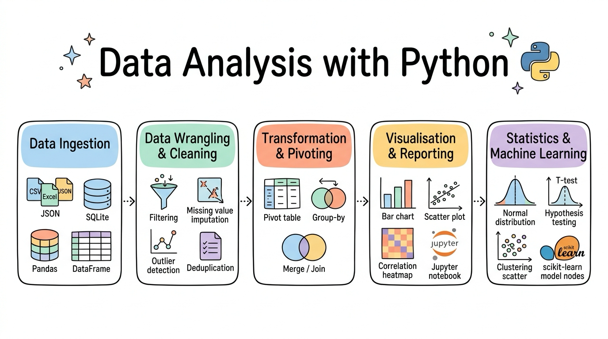
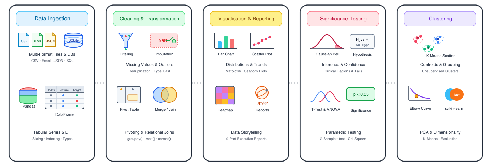

# Data Analysis with Python

[](LICENSE)
[](https://github.com/wlos/DA_with_Python/graphs/contributors)
[](https://github.com/wlos/DA_with_Python/issues)
[](https://github.com/wlos/DA_with_Python/pulls)
[](https://github.com/wlos/DA_with_Python/pulls)

[](https://github.com/wlos/DA_with_Python/watchers)
[](https://github.com/wlos/DA_with_Python/network/members)
[](https://github.com/wlos/DA_with_Python/stargazers)
[](https://mybinder.org/v2/gh/wlos/DA_with_Python/main)
[](https://github.com/wlos/DA_with_Python/discussions)



Welcome to the **Data Analysis with Python** curriculum (aligning with **ICTDBS556**). This repository provides vocational learners and data practitioners with end-to-end, code-first foundations in data analytics using the standard open-source Python stack: Pandas, Matplotlib, Seaborn, and scikit-learn.

- 🌐 **Course Website**: <https://wlos.github.io/DA_with_Python/>
- 🗺️ **Interactive Roadmap**: [Mindmap of the Course](https://wlos.github.io/DA_with_Python/mindmap.html)

## 🛠️ What You'll Build

### 🎯 Core Competencies

- **Multi-Source Data Ingestion**: Load structured CSV and Excel files, parse semi-structured JSON and server logs, and query SQLite databases using SQL from Python.
- **Data Wrangling & Cleansing**: Inspect missing values and assess imputation strategies, assess and remove duplicates, and reshape datasets with `melt()`, `pivot()`, and `groupby()`.
- **Statistical Visualisation & Reporting**: Construct publication-quality charts using Matplotlib and Seaborn, and structure findings into professional 9-part analytics reports.
- **Hypothesis Testing & Inference**: Formulate statistical hypotheses, run two-sample t-tests, one-way ANOVA, and Chi-square tests of independence, and interpret p-values.
- **Machine Learning & Clustering**: Implement reproducible scikit-learn pipelines for supervised regression and classification, PCA dimensionality reduction, and K-means clustering.

### 🏗️ Practical Projects

- **Titanic Data Cleansing & Survivability Analysis**: Handle missing cabin and age attributes, build robust imputation logic, remove spurious records, and filter survivability patterns across passenger classes.
- **Marketing Sales Intelligence Dashboard**: Combine marketing spend, product catalog, and state sales target tables using relational joins and pivot tables to generate an executive-ready business intelligence report.
- **Restaurant Gratuity Hypothesis Testing Studio**: Perform two-sample t-tests and ANOVA to examine whether tipping proportions differ significantly across gender, smoking status, and meal times.
- **Wine Chemometrics PCA & K-Means Segmentation**: Standardise multi-attribute chemical analysis data, project variance into 2D PCA space, and cluster wine cultivars using K-Means with elbow evaluation.

### 🏢 Industry Applications

Business Intelligence & Reporting · FinTech & Risk Analytics · Healthcare Informatics · Retail & E-Commerce Operations · Marketing Performance Analytics

## 💼 Career Impact

- **Technical Roles**: Data Analyst · Business Intelligence Specialist · Reporting Analyst · Junior Data Scientist · Operations Analytics Associate
- **Industry Sectors**: Financial Services & Insurance · Retail & E-Commerce · Healthcare & Life Sciences · Government & Public Sector · Market Research
- **Portfolio Projects**: Cleaned Titanic EDA notebooks · Multi-table marketing intelligence reports · Hypothesis testing statistical notebooks · PCA & K-Means clustering studies

## 📚 Content



The course is organised into modular sessions located directly under the repository root. Each session folder contains its own notebooks, explanatory diagrams, and local datasets.

| Module | Topic | Focus Area | Key Content |
| :---: | :--- | :--- | :--- |
| 📖 [01](01-Introduction-to-Data-Analysis) | [Introduction to Data Analysis](01-Introduction-to-Data-Analysis) | Course Overview & Analytics Environments | Analytics Workflow · Local vs Cloud Notebooks · Python Runtime Essentials · Variables, Types & Functions · Running Data Scripts |
| 📊 [02](02-Data-Loading-and-Pandas-Basics) | [Data Loading and Pandas Basics](02-Data-Loading-and-Pandas-Basics) | Tabular Data & DataFrame Foundations | CSV & Excel Ingestion · Series vs DataFrames · Row & Column Selection · Filtering & Indexing · Creating Calculated Features |
| 🗄️ [03](03-Structured-and-Unstructured-Data) | [Structured and Unstructured Data](03-Structured-and-Unstructured-Data) | Multi-Format Ingestion & Databases | Structured vs Semi-Structured vs Unstructured · Server Log Parsing with Regex · JSON Parsing · SQLite Databases & SQL Queries |
| 🧹 [04](04-Data-Cleaning) | [Data Cleaning](04-Data-Cleaning) | Data Quality & Imputation | Titanic Dataset Case Study · Missing Value Strategies (Drop vs Impute) · Identifying Duplicates · Boolean Mask Filtering |
| ⚙️ [05](05-Data-Transformation) | [Data Transformation](05-Data-Transformation) | Feature Engineering & Scaling | String Normalisation · Datetime Parsing & Date Arithmetic · Custom Function Vectorisation with apply() · Categorical Encoding |
| 🔄 [06](06-Data-Restructuring) | [Data Restructuring](06-Data-Restructuring) | Merging, Grouping & Reshaping | Relational Joins (Inner, Left, Right, Outer) · Concatenation · Split-Apply-Combine with groupby() · melt(), pivot() & pivot_table() |
| 📈 [07](07-Data-Visualisation) | [Data Visualisation](07-Data-Visualisation) | Exploratory Visualisation & Storytelling | Matplotlib Figure Architecture · Seaborn Statistical Charts · Comparison Charts · Distribution Charts · Relationship Scatter |
| 📝 [08](08-Reporting-with-Jupyter-Notebook) | [Reporting with Jupyter Notebook](08-Reporting-with-Jupyter-Notebook) | Professional Analytics Reporting | 9-Part Professional Report Structure · Executive Summaries · Accessible Alt Text & Chart Annotations · Exporting to HTML & PDF |
| 🔬 [11](11-Statistical-Analysis) | [Statistical Analysis](11-Statistical-Analysis) | Hypothesis Testing & Significance | Null vs Alternative Hypotheses · Sampling Distributions & Standard Error · Two-Sample Student's t-Test · p-Value Interpretation |
| 📐 [12](12-More-Statistical-Tests) | [More Statistical Tests](12-More-Statistical-Tests) | ANOVA & Categorical Independence | One-Way ANOVA Across Multiple Groups · Post-Hoc Pairwise Comparisons · Chi-Square Test of Independence · Effect Sizes |
| 🤖 [13](13-Introduction-to-Machine-Learning) | [Introduction to Machine Learning](13-Introduction-to-Machine-Learning) | Supervised Learning & Pipelines | Supervised vs Unsupervised Learning · Regression vs Classification · scikit-learn API Workflow · California Housing · MNIST Digits |
| 🔍 [14](14-Unsupervised-Learning) | [Unsupervised Learning](14-Unsupervised-Learning) | Clustering & Dimensionality Reduction | StandardScaler Preprocessing · Principal Component Analysis (PCA) · K-Means Clustering Workflow · Elbow Method & Silhouette |

## 🚀 Getting Started

### 🌐 Course Website

You can study all course notes and visual walkthroughs online without installing software by visiting the [Course Website](https://wlos.github.io/DA_with_Python/).

### ☁️ Hands-on Activities in Google Colab

Every practice notebook includes an **Open in Colab** link inside the corresponding lecture. In Colab:

1. Click **Open in Colab** from the lecture page.
2. Run the notebook from top to bottom. Each notebook automatically fetches required dataset files without requiring a local repository checkout.

### 💻 Running Locally

To work with the notebooks and code on your local computer:

1. Clone this repository and change into the course directory:
   ```bash
   git clone https://github.com/wlos/DA_with_Python.git
   cd DA_with_Python
   ```

2. Create and activate a Python virtual environment (Python 3.10 or newer is recommended):
   ```bash
   python3 -m venv .venv
   source .venv/bin/activate
   ```

3. Install course dependencies:
   ```bash
   pip install numpy pandas matplotlib seaborn scipy scikit-learn openpyxl jupyterlab
   ```

## 🎓 Other Curricula

- 🤖 [Artificial Intelligence Skill Set](https://wlos.github.io/AI_SS/) · [GitHub](https://github.com/wlos/AI_SS): PyTorch deep learning, CNNs, computer vision, and Hugging Face Transformers.
- 🔌 [Build AI Apps with REST API & MCP](https://wlos.github.io/Connect-AI-using-REST-API/) · [GitHub](https://github.com/wlos/Connect-AI-using-REST-API): REST APIs, FastAPI microservices, and Model Context Protocol (MCP).
- 🧠 [Introduction to AI with Python](https://wlos.github.io/ai_with_python_course/) · [GitHub](https://github.com/wlos/ai_with_python_course): Programming fundamentals, algorithms, robotics with micro:bit & Maqueen, and introductory AI.

## 📄 License

This repository is licensed under the [MIT License](LICENSE).
