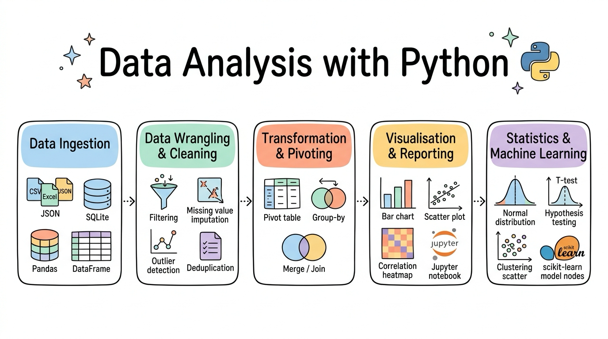
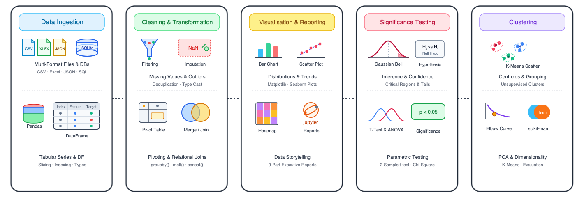

::: {.course-banner-container}
{.course-banner-img fig-alt="Data Analysis with Python Sketchnote Roadmap"}
:::

# Data Analysis with Python

Welcome to the **Data Analysis with Python** curriculum (aligning with **ICTDBS556**). This course guides learners through the end-to-end data analytics lifecycle: from loading heterogeneous data formats and executing rigorous data cleansing and transformation, to exploratory data visualisation, hypothesis testing, and statistical machine learning with scikit-learn.

🗺️ **Interactive Roadmap**: Explore our interactive [Mindmap of the Course](mindmap.html) for a zoomable, bird's-eye view of all curriculum topics and direct section links.

## 🧭 Course Navigation {#course-navigation}

::: {.course-banner-container}
{.course-banner-img fig-alt="Data Analysis with Python Curriculum Roadmap"}
:::

The curriculum is structured into modular session directories located directly under the repository root. Each session folder is completely self-contained with its own images, practice notebooks, and local datasets.

::: {.info-stack}
::: {.info-card}
#### 📖 [Session 01: Introduction to Data Analysis](<01-Introduction-to-Data-Analysis/Session1 Introduction to Data Analysis with Python.ipynb>)
[Course Overview & Analytics Environments]{.focus-badge}

Analytics Workflow · Local vs Cloud Notebooks · Python Runtime Essentials · Variables, Types & Functions · Running Data Scripts
:::

::: {.info-card}
#### 📊 [Session 02: Data Loading and Pandas Basics](<02-Data-Loading-and-Pandas-Basics/Session2 Data Loading and Pandas Basics.ipynb>)
[Tabular Data & DataFrame Foundations]{.focus-badge}

CSV & Excel Ingestion · Series vs DataFrames · Row & Column Selection · Filtering & Indexing · Creating Calculated Features · Exporting Clean Data
:::

::: {.info-card}
#### 🗄️ [Session 03: Structured and Unstructured Data](<03-Structured-and-Unstructured-Data/Session3 Loading Structured and Unstructured Data.ipynb>)
[Multi-Format Ingestion & Databases]{.focus-badge}

Structured vs Semi-Structured vs Unstructured · Server Log Parsing with Regex · JSON Parsing with read_json() · SQLite Databases & SQL Queries · Data Security Basics
:::

::: {.info-card}
#### 🧹 [Session 04: Data Cleaning](<04-Data-Cleaning/Session4 Data Cleaning.ipynb>)
[Data Quality & Missing Value Imputation]{.focus-badge}

Titanic Dataset Case Study · Missing Value Strategies (Drop vs Impute) · Identifying & Removing Deduplication Anomalies · Column Renaming · Boolean Mask Filtering
:::

::: {.info-card}
#### ⚙️ [Session 05: Data Transformation](<05-Data-Transformation/Session5 Data Transformation.ipynb>)
[Feature Engineering & Scaling]{.focus-badge}

String Normalisation · Datetime Parsing & Date Arithmetic · Custom Function Vectorisation with apply() · Categorical Encoding · Min-Max & Standard Scaling
:::

::: {.info-card}
#### 🔄 [Session 06: Data Restructuring](<06-Data-Restructuring/Session6 Data Restructuring.ipynb>)
[Merging, Grouping & Reshaping]{.focus-badge}

Relational Joins (Inner, Left, Right, Outer) · Concatenation · Split-Apply-Combine with groupby() · Hierarchical MultiIndex · Reshaping with melt(), pivot() & pivot_table()
:::

::: {.info-card}
#### 📈 [Session 07: Data Visualisation](<07-Data-Visualisation/Session7 Data Visualisation.ipynb>)
[Exploratory Visualisation & Storytelling]{.focus-badge}

Matplotlib Figure Architecture · Seaborn Statistical Charts · Comparison Charts (Bar & Count) · Distribution Charts (Histograms & Boxplots) · Relationship Scatter & Heatmaps
:::

::: {.info-card}
#### 📝 [Session 08: Reporting with Jupyter Notebook](<08-Reporting-with-Jupyter-Notebook/Session8 Reporting with Jupyter Notebook.ipynb>)
[Professional Analytics Reporting]{.focus-badge}

9-Part Professional Report Structure · Executive Summaries · Accessible Alt Text & Chart Annotations · Technical Methodology Writing · Exporting to HTML & PDF
:::

::: {.info-card}
#### 🔬 [Session 11: Statistical Analysis](<11-Statistical-Analysis/Session11 Statistical Analysis.ipynb>)
[Hypothesis Testing & Significance]{.focus-badge}

Null vs Alternative Hypotheses · Sampling Distributions & Standard Error · Two-Sample Student's t-Test · p-Value Interpretation · Multiple Comparisons Problem
:::

::: {.info-card}
#### 📐 [Session 12: More Statistical Tests](<12-More-Statistical-Tests/Session12 More Statistical Tests.ipynb>)
[ANOVA & Categorical Independence]{.focus-badge}

One-Way ANOVA Across Multiple Groups · Post-Hoc Pairwise Comparisons · Chi-Square Test of Independence · Effect Sizes & Confidence Intervals · Statistical Test Selection
:::

::: {.info-card}
#### 🤖 [Session 13: Introduction to Machine Learning](<13-Introduction-to-Machine-Learning/Session13 Introduction to Machine Learning.ipynb>)
[Supervised Learning & Pipelines]{.focus-badge}

Supervised vs Unsupervised Learning · Regression vs Classification · scikit-learn API Workflow · California Housing Regression · MNIST Digit Classification
:::

::: {.info-card}
#### 🔍 [Session 14: Unsupervised Learning](<14-Unsupervised-Learning/Session14 Unsupervised Learning.ipynb>)
[Clustering & Dimensionality Reduction]{.focus-badge}

StandardScaler Preprocessing · Principal Component Analysis (PCA) · K-Means Clustering Workflow · Elbow Method & Silhouette Scores · Customer & Wine Segmentation
:::
:::

## 🎯 Core Competencies {#core-competencies}

::: {.info-stack}
::: {.info-card}
#### 📥 Multi-Source Data Ingestion
Load structured CSV/Excel files, parse semi-structured JSON and server logs, and query SQLite databases using SQL commands from Python.
:::

::: {.info-card}
#### 🧹 Robust Data Wrangling & Cleansing
Diagnose messy real-world data, impute missing entries, handle deduplication, parse complex timestamps, and restructure wide/long tables.
:::

::: {.info-card}
#### 📊 Statistical Visualisation & Reporting
Create publication-ready visualisations using Matplotlib and Seaborn, and structure findings into comprehensive 9-part professional reports.
:::

::: {.info-card}
#### 📐 Hypothesis Testing & Statistical Inference
Formulate empirical hypotheses, compute test statistics (t-test, ANOVA, Chi-square), interpret p-values, and avoid false discovery pitfalls.
:::

::: {.info-card}
#### ⚙️ Applied Machine Learning & Clustering
Develop reproducible scikit-learn workflows for supervised regression, multi-class classification, PCA dimension reduction, and K-means clustering.
:::
:::

## 🏗️ Practical Projects {#practical-projects}

::: {.info-stack}
::: {.info-card}
#### 🚢 Titanic Data Cleansing & Survivability Analysis
Inspect missing cabin and age attributes, build robust imputation logic, remove spurious records, and filter survivability patterns across passenger classes.
:::

::: {.info-card}
#### 📊 Comprehensive Marketing Sales Intelligence Report
Combine marketing spend, product catalog, and state sales target tables using relational joins and pivot tables to generate an executive-ready business intelligence report.
:::

::: {.info-card}
#### 🍽️ Restaurant Gratuity Hypothesis Testing Studio
Perform statistical tests on restaurant dining data to examine whether tipping proportions differ significantly across gender, smoking status, and meal times.
:::

::: {.info-card}
#### 🍷 Wine Chemometrics PCA & K-Means Segmentation
Standardise multi-attribute chemical analysis data, project variance into 2D PCA space, and cluster wine cultivars using K-Means with elbow evaluation.
:::
:::

## 💼 Career Impact {#career-impact}

::: {.info-stack}
::: {.info-card}
#### 💼 Technical Roles
Data Analyst · Business Intelligence Specialist · Reporting Analyst · Junior Data Scientist · Operations Analytics Associate
:::

::: {.info-card}
#### 🏢 Industry Sectors
Financial Services & Insurance · Retail & E-Commerce · Healthcare & Life Sciences · Government & Public Sector · Market Research
:::

::: {.info-card}
#### 📁 Portfolio Projects
Cleaned Titanic EDA notebooks · Multi-table marketing intelligence reports · Hypothesis testing statistical notebooks · PCA & K-Means clustering studies
:::
:::

## 🚀 Getting Started {#getting-started}

::: {.info-stack}
::: {.info-card}
#### 🌐 In Your Browser
Read lecture materials, examine annotated visualisations, and review analysis code directly on this website without local setup.
:::

::: {.info-card}
#### ☁️ Google Colab
Run interactive notebooks in Google Colab using the **Open in Colab** badges to conduct data analysis with zero local configuration.
:::

::: {.info-card}
#### 💻 Local Development
Clone this repository and create a Python 3.10+ virtual environment (`.venv`) with `pandas`, `numpy`, `matplotlib`, `seaborn`, `scipy`, and `scikit-learn` to work locally.
:::
:::

## 🎓 Other Curricula {#other-curricula}

::: {.info-stack}
::: {.info-card}
#### 🤖 [Artificial Intelligence Skill Set](https://wlos.github.io/AI_SS/) · [GitHub Repository](https://github.com/wlos/AI_SS)
A comprehensive curriculum covering PyTorch deep learning, convolutional neural network architectures, computer vision, and Hugging Face Transformers.
:::

::: {.info-card}
#### 🔌 [Build AI Apps with REST API & MCP](https://wlos.github.io/Connect-AI-using-REST-API/) · [GitHub Repository](https://github.com/wlos/Connect-AI-using-REST-API)
Connect AI assistants to enterprise business systems through robust RESTful APIs, FastAPI microservices, and the open Model Context Protocol (MCP).
:::

::: {.info-card}
#### 🐍 [Introduction to AI with Python](https://wlos.github.io/ai_with_python_course/) · [GitHub Repository](https://github.com/wlos/ai_with_python_course)
Foundational programming, logic, algorithms, robotics with micro:bit & Maqueen, and core machine learning fundamentals for emerging coders.
:::
:::
